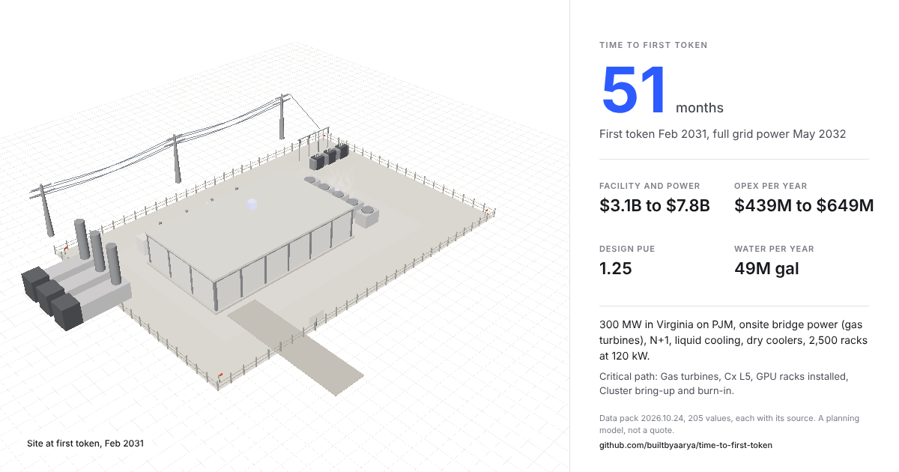
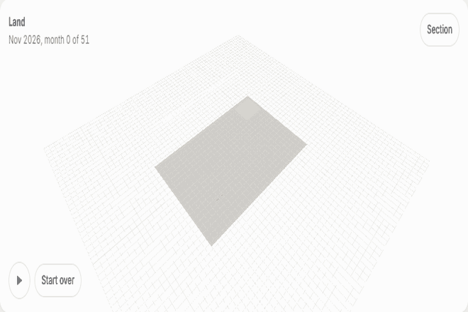
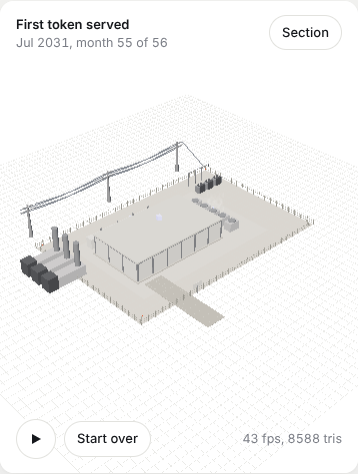
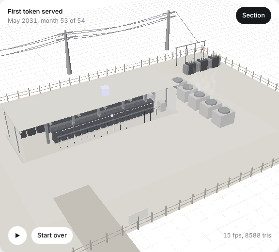
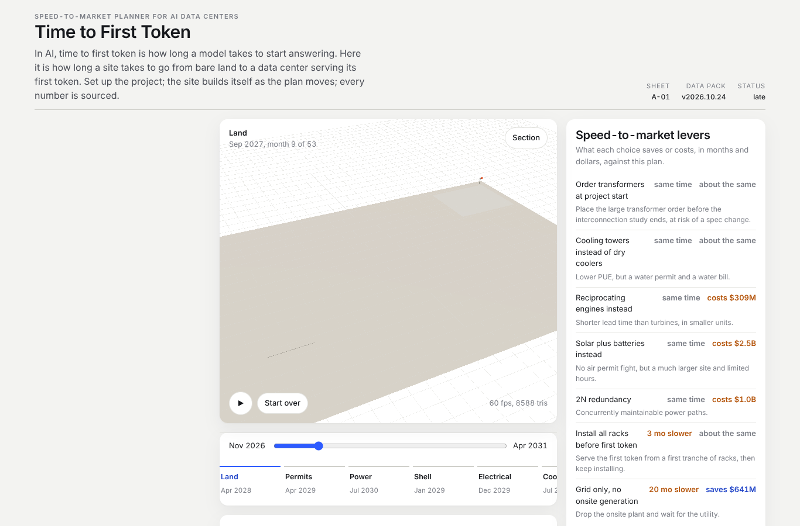

# Time to First Token

A speed-to-market planner for AI data centers. It tells you how many months it takes a site at your location and power plan to serve its first token, which choices buy those months back, what the site costs to build and run, and where every number came from.

In AI, time to first token is how long a model takes to start answering. Here it is how long a site takes to go from bare land to a data center serving its first token.

## Who it is for

- Developers screening sites and power strategies before they pay study fees, post security and hire advisors.
- Investors and lenders checking whether the schedule and capex in a memo hold up, and how much delay risk to price in.
- EPC and design-build estimators deciding which long-lead items to reserve and where bridge power changes the bid.
- Advisors who need a cited first answer in an afternoon rather than a week of pulling figures into a spreadsheet.

It is a screening tool. It does not replace a utility load study, a queue position, site control, vendor quotes or an owner's engineer; see "What it cannot tell you" below.

## Try it

- Hosted: https://builtbyaarya.github.io/time-to-first-token/ (no sign-up, nothing stored).
- Locally: clone the repo and open `index.html` through any static server, for example `python3 -m http.server`, then `http://localhost:8000/`.
- Share a plan: the link carries the inputs, and the Share card button renders a PNG of the finished site with the headline numbers.
- Get the study: enter an email on the page and a feasibility study for your exact inputs arrives as a PDF within a day. Three samples, for 300 MW in Northern Virginia on hybrid power (first token in 51 months), 100 MW in Texas on the grid (56 months) and 1,000 MW in Iowa on bridge power (62 months), are in the release assets.

## Licence, in one line

Code MIT. The data pack snapshot in this repo CC BY 4.0. The weekly refreshed pack, custom studies, a hosted team workspace and an enterprise data licence are sold; see "Commercial use" below and `LICENSE-DATA.md`.

## Contact

Open a GitHub issue on this repo: a number you dispute (with the source), a piece of the build that gates differently in your experience, or a question about commercial use. Issues are answered in the open so the next reader sees the answer too.

## What it does

Set the location, the IT load, the power strategy, the redundancy, the cooling and the accelerator generation. The site builds itself in 3D as the plan moves: land, permits, power, shell, electrical, cooling, white space, compute, commissioning Level 1 to Level 5, first token. The planner gives the critical-path schedule, the levers that save or cost months and dollars, capex and opex ranges, PUE and water, and a risk register. A stress test replays real kinds of delay on the plan. At the end you can ask for a full feasibility study for your exact inputs, emailed as a PDF.

Every number comes from a dated, versioned data pack in `data/` with its source, publisher and the date it was read. Nothing is typed in from memory. Assumptions are labelled as assumptions, in the UI and in the study.

| Phone, first token | Section view | Desktop |
|---|---|---|
|  |  |  |

## What it answers

- How many months from project start to first token, and to full grid power, for this site and this power strategy.
- What is on the critical path: the interconnection study, the large power transformers, the utility wait, the air permit, the shell, the long-lead switchgear and generators, commissioning, the racks.
- What each choice does: onsite bridge power, hybrid, ordering transformers at risk, a first phase of racks, dry coolers against towers, 2N against N+1, engines against turbines, a different state.
- Capex and opex ranges, design PUE, water use, and the risks with likelihood and impact on this plan.
- What a transformer slip, an interconnection study delay, a permit challenge, a turbine lead-time extension, a utility energization delay, a GPU allocation delay or a labour shortage does to the date.

## How it is built

- `index.html`, `css/style.css`, `js/app.js`: the page. No framework, no build step; system fonts; one accent colour.
- `js/scene.js`: the 3D site in three.js (served from `js/vendor/three`, so nothing loads from an outside CDN). One fixed sun; the camera moves, the light never does, so every shadow lands in the same place from the first stage to the last. Soft shadows, a section view that cuts the building open, racks that light up as they are commissioned, heat haze over the coolers when the site goes live. Render-on-demand, instanced racks and fence posts, a flat 2D fallback without WebGL, and no animation under `prefers-reduced-motion`.
- `js/model.js`: the planner. A critical-path calculation over the tasks a build really has, with lagged starts where fit-outs overlap, plus the cost, energy and water arithmetic. `docs/methodology.md` explains every formula.
- `data/pack.json`: the data pack. `scripts/build_pack.py` assembles it from the research files in `data/research/` and records every unit conversion and derivation. `docs/sources.md` lists the sources.
- `scripts/plan.mjs` runs the same model from the command line; `scripts/make_report.py` turns a request into the LaTeX feasibility study (executive summary and recommendation, site and grid, power strategy, permitting path, design basis, schedule and critical path, capex and opex, sensitivities, risks and mitigations, source appendix). Every figure in it carries a source number.

## Running it

Open `index.html` through any static server (the page fetches `data/pack.json`, which a `file://` URL cannot do). For example `python3 -m http.server` in the folder, then `http://localhost:8000/`.

A link carries the inputs (`?s=VA&mw=300&p=hybrid&b=gas_turbine&r=n1&c=liquid&g=gb200&d=120&t=2028-06&st=2026-11`), so two people can look at the same plan.

To build a study: `python3 scripts/make_report.py request.txt out/` where `request.txt` is the text the page writes when you ask for the study (or a JSON object of inputs). It needs `node`, and `xelatex` with the TeX Gyre Pagella fonts (it falls back to `pdflatex` with Palatino).

## The feasibility study

The page posts the email address and the inputs to a form; a scheduled job reads the new rows once a day, builds the PDF from the data pack and the inputs with `scripts/make_report.py`, and emails it. If the post fails the page says so and keeps the inputs in the link, so the request can be sent again. No fresh research is done per request, so the study and the page always agree. The address is used once and is not kept. The study is not a quote; every figure says where it came from, and the reader is asked to verify it before relying on it.

## What is real and what is a model

The pack holds 205 values, read from 77 source pages, from the Lawrence Berkeley National Laboratory, the US Energy Information Administration, the EPA, ERCOT, PJM, MISO, SPP, FERC, Dominion, state and county permitting pages, the Uptime Institute, Cushman & Wakefield, JLL, Wood Mackenzie, NVIDIA and vendor spec sheets, company filings and the trade press. Where a figure exists only in a secondary source, the pack says so. Where no public figure exists at all (eighteen values: a civil-works duration, a bring-up month, the construction scaling exponent, a GPU allocation delay and a few sizing ratios), the pack labels it an assumption and the UI shows the label.

The model is a planning model. It does not know your utility's queue position, your county's board, or your turbine slot. It is meant to show what drives the date and the money, and to be re-run as the real figures come in.

## What it cannot tell you

- Your utility's queue position, study result or energization date; the pack carries published process timelines and waits, not your file.
- Site control, title, geotech, environmental findings or local politics.
- Vendor quotes or real slot reservations for transformers, switchgear, turbines or GPUs.
- Anything an owner's engineer, a lender's independent engineer or a stamped design would sign.

It is meant to show what drives the date and the money, and to be re-run as the real figures come in.

## The audit

Before 1.0.0 shipped, an independent data audit checked the pack against its sources (252 checks across the model-driving values, the derived values recomputed from the research inputs, the assumptions and their labelling, and a sample of context values), and a separate industry review read the model, the page and a sample study in the role of a data center development director (25 items, five of them blockers). The blockers and the failing checks were fixed in the 1.0.0 release; the two reports are published as written in `docs/audit/`, line numbers and all, so you can see what was found and check the fixes yourself.

## Commercial use

The code is MIT and the pack snapshot in this repo is CC BY 4.0, so you may use both commercially, with credit, at no charge. What costs money is upkeep, because a schedule number from last year is already suspect:

| Item | Who it is for | What you get |
|---|---|---|
| Weekly refreshed data pack | Development, investment and estimating teams | EIA state prices, Henry Hub, ERCOT large-load figures and new filings pulled weekly, with a changelog of what moved and its source; commercial licence, org-wide, no seat counting |
| Custom cited study | Anyone screening a named site | The study for your inputs with your site-specific sources added, reviewed by the author, with a cover note on what the tool cannot know |
| Hosted team workspace | Teams | Saved scenarios, shared access, always on the latest pack; bundled with the weekly pack in the first year |
| Enterprise data-pack licence | Larger developers, lenders, advisors | The live pack inside your own models, as a feed, with your private sources added |

Introductory prices, set to be tested and subject to change: custom study $1,500 for the first five, then $3,500; weekly pack $250 a month or $2,500 a year per organisation; enterprise licence from $10,000 a year. The free snapshot is always a full pack, only older; it is cut from the weekly pack each quarter. To buy or to ask, open a GitHub issue titled "Commercial use".

The study is a planning study, not engineering, legal or investment advice, and not a quote.

## Roadmap

See `ROADMAP.md`. `CHANGELOG.md` records what shipped.

## Licence

Code MIT (`LICENSE`). Data pack snapshot CC BY 4.0 (`data/LICENSE`); the sold items carry a commercial licence (`LICENSE-DATA.md`). Sibling project: [Solar Factory: Survive to 2030](https://github.com/builtbyaarya/solar-factory-game).

Built by Aarya.
